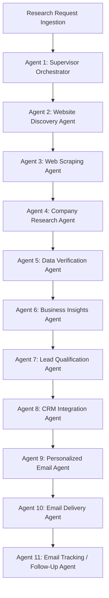

# Multi-Agent Architecture & Specialist Agent Specification

The platform orchestrates 11 specialized autonomous agents under the coordination of the Supervisor Engine.

---

### Specialist Agents Detailed Matrix

| Agent | Input Contract | Core Responsibility | Output Contract | Security & Guardrails |
|---|---|---|---|---|
| **1. Supervisor** | `ResearchRequest` | State machine execution, step transitions, budget tracking, failure recovery. | `WorkflowExecutionResult` | Enforces max token budget (\$2.00/run) & max execution timeout (300s). |
| **2. Discovery** | `SeedDomain, CrawlConfig` | Breadth-first crawl of sitemap and navigation, page classification. | `DiscoveryResult (URLs, Categories)` | Scope limit: rejects external/third-party domains. Max 50 pages. |
| **3. Web Scraping** | `TargetURLList` | HTTPX / Playwright rendering, HTML sanitization, text extraction. | `List[ScrapedPage]` | Strict SSRF filter, robots.txt check, per-domain rate limit (3 req/s). |
| **4. Company Research** | `List[ScrapedPage]` | Structured extraction of business model, offerings, tech, leadership. | `RawCompanyProfile` | Zero hallucination constraint: citations mandatory for all fields. |
| **5. Data Verification** | `RawCompanyProfile` | Cross-source deduplication, conflicting fact reconciliation. | `VerifiedCompanyProfile` | Evidence quality scoring (0.0-1.0); unverified claims labeled `provisional`. |
| **6. Business Insights** | `VerifiedCompanyProfile` | Value propositions, opportunities, operational pain points. | `BusinessInsightReport` | Pain points explicitly categorized as *Hypotheses Requiring Validation*. |
| **7. Lead Qualification** | `VerifiedProfile, ScoringConfig` | Deterministic weighted scoring across 5 dimensions (0-100). | `LeadScoreResult` | Transparent rule breakdown. AI scores are never treated as objective truth. |
| **8. CRM Sync** | `VerifiedProfile, LeadScore` | Idempotent upsert of Company, Contact, Facts, Activity records. | `CRMSyncResult` | Database transactions with row-level locking. No unrestricted LLM SQL. |
| **9. Email Drafting** | `Company, Contact, Insights` | Context-aware outreach draft quoting verified facts and value prop. | `EmailDraft` | No deceptive familiarity, no clickbait or unsubstantiated claims. |
| **10. Email Delivery** | `EmailDraft, ApprovalStatus` | Outbox staging, eligibility check, suppression check, provider dispatch. | `DeliveryReceipt` | Double-send idempotency key check; mandatory human approval gate. |
| **11. Tracking & Reply** | `WebhookPayload` | Webhook signature verification, bounce/complaint handling, suppression. | `TrackingEvent` | Automatic suppression on Hard Bounce / Spam Complaint. |
