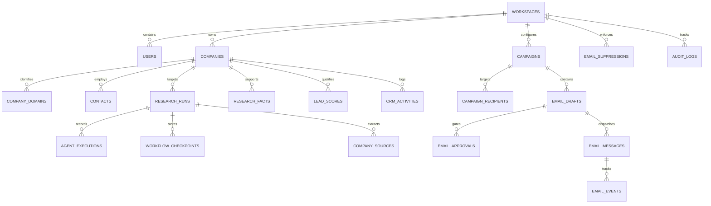

# Database Architecture & Schema Specification

The database is built on **PostgreSQL 16** using **SQLAlchemy 2.x Declarative Models** with **Alembic** migrations.
All schemas are scoped with `workspace_id` for multi-tenant data isolation.

---

### Entity Relationship Model

---

### Table Inventory & Constraints

1. `workspaces`: UUID PK, `name`, `slug` (UNIQUE), `created_at`, `updated_at`.
2. `users`: UUID PK, `workspace_id` FK, `email` (UNIQUE per workspace), `password_hash`, `full_name`, `role` (`ADMIN`, `MEMBER`, `VIEWER`), `is_active`.
3. `roles`: Role definitions and capability permission bitmasks.
4. `workspace_members`: Composite user-workspace membership mappings.
5. `companies`: UUID PK, `workspace_id` FK, `name`, `primary_domain` (INDEX), `legal_name`, `industry`, `employee_range`, `description`, `headquarters`, `status` (`PROSPECT`, `RESEARCHING`, `QUALIFIED`, `CONTACTED`, `UNQUALIFIED`, `CUSTOMER`), `pipeline_stage_id`.
6. `company_domains`: UUID PK, `company_id` FK, `domain` (UNIQUE INDEX), `is_primary`.
7. `contacts`: UUID PK, `workspace_id` FK, `company_id` FK, `first_name`, `last_name`, `email` (INDEX), `title`, `phone`, `linkedin_url`, `provenance_url`, `permission_status` (`LEGITIMATE_INTEREST`, `EXPLICIT_CONSENT`, `UNKNOWN`), `is_suppressed`.
8. `company_sources`: UUID PK, `company_id` FK, `url`, `http_status`, `content_hash`, `retrieved_at`, `raw_html_ref`.
9. `research_runs`: UUID PK, `workspace_id` FK, `company_id` FK, `status` (`PENDING`, `RUNNING`, `COMPLETED`, `FAILED`), `triggered_by`, `config_snapshot`, `created_at`, `completed_at`.
10. `agent_executions`: UUID PK, `research_run_id` FK, `agent_name`, `state`, `input_payload`, `output_payload`, `tokens_used`, `cost_usd`, `duration_ms`, `error_message`.
11. `workflow_checkpoints`: UUID PK, `research_run_id` FK, `state`, `step_index`, `state_data` (JSONB), `created_at`.
12. `research_facts`: UUID PK, `company_id` FK, `run_id` FK, `field_name`, `field_value`, `source_url`, `confidence_score` (FLOAT), `verification_status` (`VERIFIED`, `PROVISIONAL`, `CONTRADICTED`), `created_at`.
13. `research_reports`: UUID PK, `company_id` FK, `executive_summary`, `challenges_hypotheses` (JSONB), `opportunities` (JSONB), `tech_stack` (JSONB).
14. `lead_scores`: UUID PK, `company_id` FK, `total_score` (0-100), `industry_score`, `service_score`, `scale_score`, `opportunity_score`, `evidence_score`, `is_qualified` (BOOL).
15. `lead_score_explanations`: UUID PK, `lead_score_id` FK, `dimension`, `reason`, `score_assigned`.
16. `crm_pipelines`: UUID PK, `workspace_id` FK, `name`, `is_default`.
17. `crm_stages`: UUID PK, `pipeline_id` FK, `name`, `order_index`, `color`.
18. `crm_activities`: UUID PK, `workspace_id` FK, `company_id` FK, `contact_id` FK, `activity_type` (`NOTE`, `CALL`, `EMAIL_SENT`, `STATUS_CHANGE`, `RESEARCH_DONE`), `details` (JSONB), `created_by`.
19. `email_templates`: UUID PK, `workspace_id` FK, `name`, `subject_template`, `body_template`, `variables` (JSONB).
20. `email_campaigns`: UUID PK, `workspace_id` FK, `name`, `status` (`DRAFT`, `ACTIVE`, `PAUSED`, `COMPLETED`), `auto_send_enabled` (BOOL), `template_id` FK, `daily_limit`.
21. `campaign_recipients`: UUID PK, `campaign_id` FK, `contact_id` FK, `status` (`QUEUED`, `DRAFTED`, `APPROVED`, `SENT`, `FAILED`, `EXCLUDED`).
22. `email_drafts`: UUID PK, `campaign_id` FK, `contact_id` FK, `subject`, `body_html`, `body_text`, `referenced_facts` (JSONB), `status` (`PENDING_APPROVAL`, `APPROVED`, `REJECTED`).
23. `email_approvals`: UUID PK, `draft_id` FK, `reviewed_by` FK, `decision` (`APPROVED`, `REJECTED`, `EDITED`), `feedback`, `decided_at`.
24. `email_messages`: UUID PK, `workspace_id` FK, `draft_id` FK, `contact_id` FK, `provider_name`, `provider_message_id` (INDEX), `idempotency_key` (UNIQUE), `sent_at`, `status` (`SENT`, `DELIVERED`, `BOUNCED`, `FAILED`).
25. `email_events`: UUID PK, `email_message_id` FK, `event_type` (`DELIVERED`, `OPENED`, `CLICKED`, `BOUNCED`, `COMPLAINT`, `UNSUBSCRIBED`), `payload` (JSONB), `timestamp`.
26. `email_suppressions`: UUID PK, `workspace_id` FK, `email` (UNIQUE per workspace), `reason` (`BOUNCE`, `COMPLAINT`, `UNSUBSCRIBE`, `MANUAL`), `created_at`.
27. `scheduled_tasks`: UUID PK, `workspace_id` FK, `task_type`, `schedule_cron`, `last_run_at`, `next_run_at`, `is_active`, `payload` (JSONB).
28. `webhook_events`: UUID PK, `provider`, `event_id` (UNIQUE), `payload` (JSONB), `status` (`PROCESSED`, `FAILED`), `processed_at`.
29. `audit_logs`: UUID PK, `workspace_id` FK, `user_id`, `action`, `resource_type`, `resource_id`, `ip_address`, `details` (JSONB), `timestamp`.
30. `integration_configs`: UUID PK, `workspace_id` FK, `provider_type`, `encrypted_credentials`, `is_enabled`, `updated_at`.
