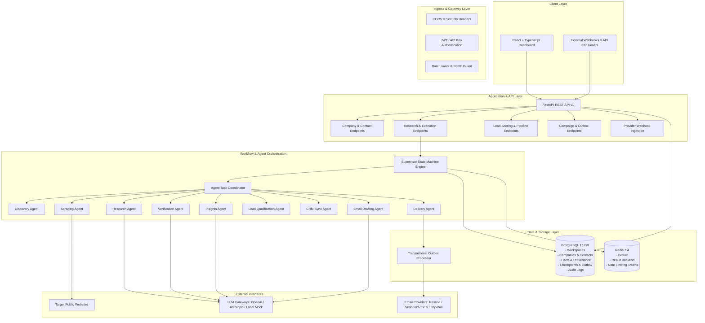

# High-Level Design (HLD)
## Multi-Agent Company Intelligence & Outreach Automation Platform

### 1. System Architecture Overview

The platform uses a layered Clean Architecture pattern combining asynchronous event-driven background processing with a high-performance REST API and a responsive modern frontend.

---

### 2. Core Architectural Principles

1. **Deterministic Authority over Non-Deterministic Agents:**
   - LLMs generate structured proposals (JSON schemas via Pydantic).
   - Python core services strictly validate, enforce business rules, perform database operations, apply rate limits, check permissions, and manage outbox dispatches.
   - LLMs never directly write SQL, execute untrusted system commands, or initiate network dispatches without policy compliance.

2. **Durable Workflow State Machine:**
   Workflows progress through verifiable transitions:
   `CREATED` $\to$ `VALIDATING` $\to$ `DISCOVERING` $\to$ `EXTRACTING` $\to$ `RESEARCHING` $\to$ `VERIFYING` $\to$ `ANALYZING` $\to$ `SAVING` $\to$ `EMAIL_PREPARATION` $\to$ `APPROVAL_PENDING` $\to$ `SENDING` $\to$ `COMPLETED`
   (with terminal and recovery states: `FAILED`, `CANCELLED`, `PARTIALLY_COMPLETED`, `RETRY_PENDING`).
   Every transition saves an immutable snapshot in `workflow_checkpoints`.

3. **Multi-Tenancy & Workspace Isolation:**
   Every entity belongs to a `workspace_id`. Cross-workspace queries are strictly partitioned at the repository and ORM layer.

4. **Transactional Outbox for Outbound Communications:**
   Outbound emails are saved in an `outbox` table within the same ACID transaction as the state transition. A dedicated asynchronous outbox worker dispatches the email via the chosen provider adapter with an idempotency key, preventing phantom double-sends even under worker restarts or HTTP timeouts.

5. **Defense-in-Depth Web Extraction:**
   All crawled URLs pass through an SSRF validator blocking private subnets (RFC 1918, 127.0.0.0/8, 169.254.0.0/16, IPv6 loopback, cloud metadata endpoints). Redirect chains are strictly capped (max 5) and re-validated at each hop.
